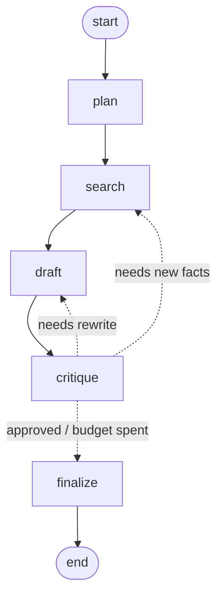

# LangGraph Research Agent

A self-correcting research agent built as a **cyclic LangGraph state machine** and served over an
**async FastAPI** API with **Pydantic** validation throughout.

Given a question, the agent plans search queries, fetches Wikipedia sources concurrently, writes a
cited answer, and has an LLM critic review it. Based on the critique, the graph either **finishes**,
**loops back to rewrite** the draft, or **loops back to search** for missing facts. A bounded
iteration budget makes sure it always stops.

## Architecture



| Node | Does |
|---|---|
| `plan` | LLM breaks the question into 1-4 search queries (structured output → `Plan`) |
| `search` | Runs all pending queries **concurrently** (`asyncio.gather` + `httpx.AsyncClient`) |
| `draft` | Writes or revises a cited answer, using the critic's feedback when it exists |
| `critique` | LLM reviewer returns a `Critique` (score, approved, feedback, missing_info_queries) |
| `finalize` | Records why the run stopped (`approved` or `max_iterations`) |

### State management

State is a `TypedDict` (`research_agent/state.py`) where each key has an explicit **reducer**:

- `sources` uses a custom `merge_sources` reducer, so new search results are **appended and
  de-duplicated by URL** instead of overwriting earlier ones.
- `searched_queries` and `trace` are append-only (`operator.add`).
- `draft`, `critique`, `pending_queries` and `iteration` are overwritten by each node.

### Loop control

`route_after_critique` is the only branching point. Three mechanisms stop infinite cycles:

1. **Iteration budget:** each `draft` increments `iteration`. Once it reaches `max_iterations`
   (1-5, validated by Pydantic), the graph goes to `finalize` even if the critic isn't satisfied.
2. **Query de-duplication:** the critic's suggested queries are filtered against `searched_queries`,
   so the research loop can't keep re-running the same search.
3. **`recursion_limit`:** LangGraph's own step cap acts as a final backstop.

### Model fallback chain

Free LLM endpoints are often rate-limited, so the LLM layer is built as an **ordered chain of models**
(`MODEL` first, then `FALLBACK_MODELS`). With `AUTO_DISCOVER_FREE_MODELS=true`, it also appends any
OpenRouter free models that currently support structured output, found through OpenRouter's models API.
A call moves down the chain when a model:

- raises an error (a 429 rate limit, an outage or a timeout), after `LLM_MAX_RETRIES` retries,
- returns an empty completion, or
- returns structured output that fails **Pydantic validation** against `Plan` / `Critique`.

On top of that, each LLM node has a LangGraph `RetryPolicy` (3 attempts, exponential backoff), so a
brief outage of every model in the chain still doesn't fail the run. The CLI logs which model
produced each step.

## Project layout

```
research_agent/
  schemas.py   Pydantic models: Plan, Critique, Source, ResearchRequest/Response
  state.py     Graph state + reducers
  graph.py     Nodes, conditional routing, graph compilation
  brain.py     LLM layer (Brain protocol + LangChain implementation)
  search.py    Async Wikipedia search
  api.py       FastAPI app: /health, /research, /research/stream (SSE)
  config.py    pydantic-settings configuration + model chain
  openrouter.py  Discovery of free models that support structured output
  __main__.py  CLI
tests/         Offline tests using a scripted fake LLM
```

Nodes depend on a `Brain` **protocol**, not on a concrete LLM. The tests use a scripted fake to
check every routing path deterministically, without network access or API keys.

## Setup

```bash
python -m venv .venv
.venv\Scripts\activate          # Windows  (source .venv/bin/activate on macOS/Linux)
pip install -r requirements.txt
copy .env.example .env          # then put your API key in .env
```

The model is set with `MODEL` in `.env`. Any `provider:model` string supported by LangChain's
`init_chat_model` works, e.g. `google_genai:gemini-2.5-flash` or `anthropic:claude-sonnet-5`.

## Run

```bash
# CLI
python -m research_agent "How does CRISPR-Cas9 edit genes, and what are its risks?"

# API  (interactive docs at http://127.0.0.1:8000/docs)
uvicorn research_agent.api:app --reload

curl -X POST http://127.0.0.1:8000/research -H "Content-Type: application/json" \
     -d "{\"question\": \"How does CRISPR-Cas9 edit genes?\", \"max_iterations\": 3}"

# Stream progress as Server-Sent Events
curl -N -X POST http://127.0.0.1:8000/research/stream -H "Content-Type: application/json" \
     -d "{\"question\": \"How does CRISPR-Cas9 edit genes?\"}"
```

## Tests

```bash
pytest -q
```

The tests cover the straight-through path, the revision loop, the research loop and source
merging, query de-duplication, the iteration cap, request validation (HTTP 422), SSE streaming, and the model\nfallback chain (errors, empty output, invalid structured output, discovery filtering).
