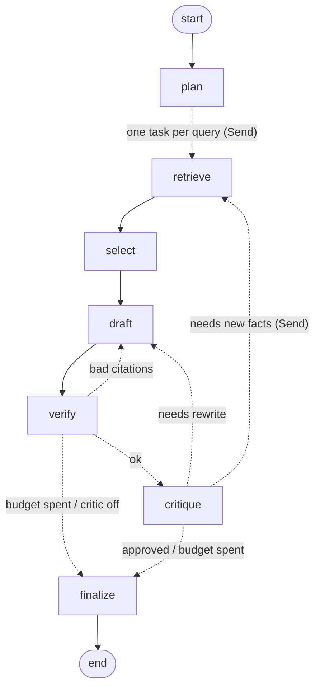

# LangGraph Research Agent

A self-correcting research agent built as a **cyclic LangGraph state machine**, served over an
**async FastAPI** API with **Pydantic** validation throughout.

Given a question, the agent plans search queries, retrieves Wikipedia passages in parallel, writes a
cited answer, checks its citations, and has an LLM critic review it. Depending on the outcome it
**finishes**, **rewrites** the draft, or **goes back to search** for missing facts. Conversations are
checkpointed to SQLite, so follow-up questions work.

## Results

Pilot evaluation on **6 HotpotQA questions** (dev set, 3 bridge + 3 comparison, sampled with a fixed
seed). The agent and the baseline use the same retriever, ranker, prompt and models
(`nvidia/nemotron-3-super-120b-a12b:free` with fallbacks).

| | Single-pass RAG baseline | Agent |
|---|---|---|
| Exact match | 0% (0/6) | **67% (4/6)** |
| Answer found (lenient) | 0% | **83%** |
| Gold Wikipedia pages retrieved | 0% | **83%** |
| Valid citations | 67% | **100%** |
| Avg LLM calls / tokens | 1.0 / ~1.4k | 3.2 / ~6.8k |
| Median latency | 18s | 54s |
| Failed LLM calls absorbed by fallback | 4 | 10 |
| Failed runs | 0 | 0 |

**Read these with care:**

- **n = 6.** This is a pilot, limited by a free tier of 50 LLM requests a day, not a benchmark score.
- **The baseline is weak.** It searches Wikipedia with the raw question, and Wikipedia's search needs
  every word to match, so it retrieved nothing relevant for any of the 6 questions. The gap mainly
  shows the value of query planning, rather than of the critique loop.
- **The agent's misses:** one ambiguously worded question (`American Beauty`), and one that needs
  counting books across two articles (`Updike / Clancy`).

**Retrieval benchmark** (8 queries, median of 3 rounds, no LLM calls, 0 failed requests):

| | Time |
|---|---|
| Sequential fetching | 14.4s |
| Concurrent fetching (max 4 in flight) | **5.2s (2.8× faster)** |
| Repeat query served from cache | **~14 ms** |

Raw results are in [`evals/results/`](evals/results).

## Architecture



| Node | Does |
|---|---|
| `plan` | LLM breaks the question into 1-4 search queries (structured output: `Plan`) |
| `retrieve` | One parallel task per query: Wikipedia search, full-article fetch, chunking into passages |
| `select` | Ranks all retrieved passages with **BM25** and keeps the top 8 (max 3 per article) |
| `draft` | Writes or revises a cited answer plus a short answer (structured output: `Draft`) |
| `verify` | Deterministic check that every `[n]` citation points to a real source |
| `critique` | LLM reviewer returns a `Critique` (score, approved, feedback, missing-info queries) |
| `finalize` | Records why the run stopped and appends the turn to the conversation history |

### State and memory

State is a `TypedDict` (`research_agent/state.py`) where each key has a **reducer**:

- `evidence` uses a custom reducer that merges new passages and **de-duplicates them by ID**.
- `history`, `searched_queries` are append-only; `trace` and `turn_queries` are append-only within a
  turn and reset at the start of the next one.
- `draft`, `critique`, `sources` and `iteration` are overwritten.

The graph is compiled with a **SQLite checkpointer**, so state is saved after every step, keyed by a
`thread_id`. Passing the same `thread_id` again continues the conversation: the planner and writer
see previous turns, and evidence from earlier turns stays available.

### Loop control

Every path back to `draft` increases `iteration`, and the routers check the budget first, so the
graph always terminates:

1. **Iteration budget** (`max_iterations`, 1-5).
2. **Query de-duplication**: the critic's suggested queries are filtered against everything already
   searched.
3. **Critic only when it can matter**: on the last allowed draft, the critic is skipped.
4. **`recursion_limit`**: LangGraph's step cap as a final backstop.

### Reliability

- **Model fallback chain:** `MODEL`, then `FALLBACK_MODELS` (and optionally auto-discovered free
  OpenRouter models that support structured output). A call moves down the chain when a model errors,
  returns an empty answer, or returns output that fails **Pydantic validation**.
- **Retries:** per-model client retries, plus a LangGraph `RetryPolicy` with exponential backoff on
  every LLM node.
- **Polite retrieval:** at most 4 concurrent Wikipedia requests, with retries on 429/5xx that respect
  `Retry-After`. Without this, Wikipedia rate-limited the parallel requests and they silently returned
  nothing.
- **Caching:** Wikipedia responses and LLM outputs are cached in SQLite, so a repeated question costs
  no requests.
- **Timeouts:** each API request is capped (HTTP 504 when exceeded).

### Observability

Every response includes per-node latency, LLM calls (including failed ones), tokens, cache hits and
which model answered, collected through a LangChain callback handler.

## Project layout

```
research_agent/
  graph.py       Nodes, routing, citation verifier, graph compilation
  state.py       Graph state + reducers
  schemas.py     Pydantic models (Plan, Draft, Critique, request/response, metrics)
  brain.py       LLM layer: Brain protocol, prompts, model fallback chain
  search.py      Async Wikipedia retrieval with concurrency limit and retries
  retrieval.py   Chunking and BM25 ranking
  cache.py       SQLite cache + CachedBrain wrapper
  metrics.py     Per-run metrics (LangChain callback handler)
  runner.py      Builds the agent; shared by the API, CLI and evaluation
  api.py         FastAPI app
  config.py      pydantic-settings configuration
  openrouter.py  Discovery of free models that support structured output
  __main__.py    CLI
evals/
  hotpotqa.py         Downloads the fixed HotpotQA sample
  baseline.py         Single-pass RAG baseline
  run.py              Evaluation runner (resumable, with an LLM-call budget)
  scoring.py          EM, F1, lenient answer match, gold-page recall
  bench_retrieval.py  Retrieval latency benchmark
tests/              34 offline tests (scripted fake LLM and searcher, mocked HTTP)
```

## Setup

```bash
python -m venv .venv
.venv\Scripts\activate          # Windows  (source .venv/bin/activate on macOS/Linux)
pip install -r requirements.txt
copy .env.example .env          # then put your API key in .env
```

`MODEL` accepts any `provider:model` string supported by LangChain's `init_chat_model`, e.g.
`google_genai:gemini-2.5-flash`, or an OpenRouter model with `openai:` and `BASE_URL` set.

## Run

```bash
# CLI
python -m research_agent "Were Scott Derrickson and Ed Wood of the same nationality?"
python -m research_agent "When was he born?" --thread <thread id printed by the first run>

# API  (interactive docs at http://127.0.0.1:8000/docs)
uvicorn research_agent.api:app --reload
```

| Endpoint | |
|---|---|
| `POST /research` | `{"question": ..., "max_iterations": 3, "thread_id": optional}`; returns the answer, sources, `thread_id` and metrics |
| `POST /research/stream` | Same, as Server-Sent Events: one event per finished step, then the result |
| `GET /threads/{thread_id}` | The conversation so far |
| `GET /health` | Status and model chain |

## Evaluation

```bash
python -m evals.hotpotqa --per-type 3        # fetch the fixed sample (already in evals/data)
python -m evals.run --limit 6 --max-llm-calls 40
python -m evals.run --rescore-only           # recompute metrics from saved results, no LLM calls
python -m evals.bench_retrieval              # retrieval latency, no LLM calls
```

Results are appended per question, so an interrupted run resumes where it stopped.

## Tests

```bash
pytest -q --cov=research_agent
```

34 tests, 86% coverage of `research_agent`. They cover every routing path, parallel fan-out, citation
checking, multi-turn memory, the API (validation, threads, streaming), the fallback chain, caching,
BM25 ranking, Wikipedia retries and the evaluation metrics. They run offline, with no API keys.

## Limitations

- Retrieval is Wikipedia only, ranked with BM25 (no embeddings).
- The critic is also an LLM, so it can be lenient.
- The evaluation sample is small (see Results).
- The API has no authentication.
